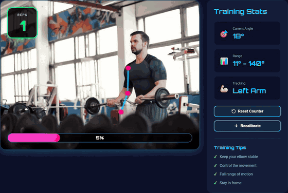
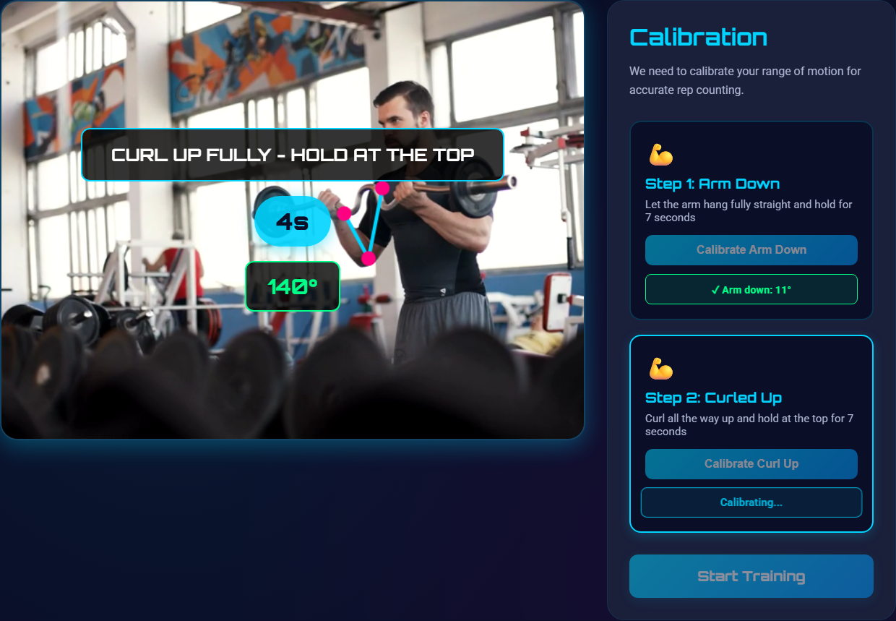
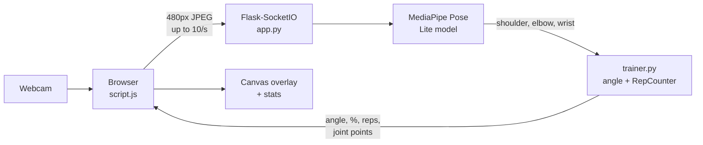

# AI Fitness Trainer

Counts bicep curls from your webcam in the browser. MediaPipe Pose finds your shoulder, elbow and wrist,
the server turns them into an elbow angle, and a two-pose calibration maps that angle onto your own
range of motion so a rep only counts when you curl to the top of that range and lower back to the bottom.

[](https://github.com/ParshvCrafts/AI-Fitness-Trainer/actions/workflows/ci.yml)
[](LICENSE)



<sub>Recorded from the real app in headless Chromium by <a href="tools/capture_demo.py"><code>tools/capture_demo.py</code></a>.
The webcam is replaced by a free <a href="https://mixkit.co/free-stock-video/bodybuilder-exercising-his-biceps-in-the-gym-21272/">Mixkit stock clip</a>
(calibration used two held still frames from it); pose detection, counting and the UI are the unmodified app.
The 10 s loop starts mid-set, so the counter shows 1 → 4.</sub>

## What it does

- **Two-pose calibration.** You hold your arm straight, then fully curled, for 7 seconds each. The server
  averages the angle in each pose and uses that as your range, so the thresholds follow your own
  range of motion instead of fixed angles. A range under 30° is rejected with a message instead of silently counting nothing.
- **Hysteresis rep counting.** Progress is your angle as a percentage of that range. A rep counts only
  after you reach 95% and then return to 5% or less, so bouncing in the middle of the range does not add reps.
- **Left or right arm.** The angle comes from a dot product, which gives the same number for either arm
  and for a mirrored camera.
- **Smooth preview.** The browser paints the camera at full frame rate and draws the tracked shoulder,
  elbow and wrist on top. Up to 10 times a second a 480 px JPEG goes up; the reply is three joint points
  plus angle, progress and count, a few hundred bytes.

<p align="center">
  
</p>

## How it works



| Piece | File | Notes |
|---|---|---|
| Rep logic | [`trainer.py`](trainer.py) | `elbow_flexion()` and `RepCounter`. No Flask or MediaPipe imports, so it is unit-tested directly. |
| Server | [`app.py`](app.py) | One MediaPipe `Pose` and one `RepCounter` per Socket.IO connection. |
| Client | [`static/script.js`](static/script.js) | Two loops: display (every animation frame) and send (100 ms, one frame in flight). |

Design choices and what they cost:

- **Server-side inference instead of MediaPipe in the browser.** Keeps the client a plain page and the
  model in one place. The cost is a network round trip per frame and server CPU per user, which is why
  frames are downscaled to 480 px and sent at most 10 times a second.
- **`static_image_mode=True`.** Each frame is detected from scratch. Slower than tracking mode, but frames
  that arrive late or after a dropped one cannot confuse a tracker.
- **Flexion, not the raw interior angle.** The app reports `180° − interior angle`, so 0° means a straight
  arm and bigger numbers mean more curl. Calibration sorts the two held poses, so the order you do them in
  does not matter.
- **One gunicorn worker.** Session state lives in process memory, so the deploy runs a single eventlet worker.

Server time per frame (JPEG decode + pose + angle, excluding network and browser work), from the demo
recording: median **38 ms**, p90 59 ms over 99 frames (Intel i9-14900HX laptop, CPU only, headless Chromium
with a fake camera). `capture_demo.py` prints these numbers on every run.

## Quick start

Python 3.11 and a webcam. Browsers allow camera access on `localhost` without HTTPS.

```bash
git clone https://github.com/ParshvCrafts/AI-Fitness-Trainer.git
cd AI-Fitness-Trainer
python -m venv venv
source venv/bin/activate        # Windows: venv\Scripts\activate
pip install -r requirements.txt
python app.py                   # http://localhost:5000
```

Browsers only give camera access on `localhost` or over HTTPS, so to use it from a phone, deploy it
(Render serves HTTPS) rather than opening the LAN address.

Then: **Get Started → pick an arm → Enable Camera → Calibrate Arm Down → Calibrate Curl Up → Start Training.**
Face the camera with your whole arm in frame (the tested footage is front-on; a plate or bar hiding
the wrist from a side view gives poor angles).

Docker: `docker build -t ai-fitness-trainer . && docker run -p 5000:5000 ai-fitness-trainer`.

### Tests

```bash
pip install pytest
pytest -v
```

19 tests. `tests/test_trainer.py` covers the angle maths and counting rules, including the elbow angles
recorded from the whole demo clip (5 curls → 5 reps). `tests/test_app.py` sends frames through the real
Socket.IO handlers (Flask-SocketIO test client, threading mode) and the real MediaPipe model, using two
frames from the clip in [`tests/fixtures/`](tests/fixtures). The production eventlet server is exercised by
`capture_demo.py` and by CI, which also builds the Docker image and checks that it serves the page.

### Deploy

[`render.yaml`](render.yaml) is a Render Blueprint (free plan, gunicorn + eventlet, Python 3.11.9,
generated `SECRET_KEY`): in Render choose **New → Blueprint** and pick this repo.

## Desktop prototype

[`desktop/`](desktop) is the original OpenCV version this web app grew out of: an elbow-angle counter in a
local window. By default it runs on a bundled video; with `USE_WEBCAM = True` it offers manual or automatic
calibration through terminal prompts. It has its own `PoseDetector` (`pose_module.py`) and does not share
`trainer.py`.

```bash
cd desktop
pip install -r requirements.txt
python ai_trainer.py            # set USE_WEBCAM = True at the top for a live camera
```

## Status

Verified (November 2026):
- Unit and Socket.IO end-to-end tests pass locally on Python 3.11 with MediaPipe 0.10.8. CI runs the
  same suite on the pinned `requirements.txt` (MediaPipe 0.10.14); see the badge for its latest result.
- Full browser flow (calibration → training → counting) in headless Chromium with a fake camera, as in the demo.

Fixed in November 2026, each with a regression test:
- The calibration screen asked for the curled pose first, which produces the *larger* angle; the server
  then refused to calibrate and no rep was ever counted (reproduced by replaying the test frames through
  the previous `app.py`). Calibration now accepts the poses in either order.
- The server sent back a full annotated JPEG that the page drew over the live preview, so after the first
  reply the user saw an un-mirrored ~10 fps image. It now returns three joint points (the test checks
  the server reply; the browser drawing is checked by eye in the demo).

Not verified:
- A live webcam session with a person since these changes. Please open an issue if counting misbehaves.
- The hosted Render deployment is offline; `render.yaml` has not been redeployed.
- Mobile browsers.

## Project structure

```
app.py               Flask-SocketIO server: frames in, angle/reps/joints out
trainer.py           elbow angle + RepCounter (pure Python)
templates/index.html single-page UI (landing, setup, calibration, training)
static/              script.js (camera, loops, overlay), style.css
tests/               pytest suite + two fixture frames (pytest.ini sets the path)
tools/               capture_demo.py (README GIF + screenshots from the running app),
                     make_social_preview.py
desktop/             original OpenCV prototype
render.yaml, Procfile, runtime.txt   Render / Heroku-style deploy
Dockerfile, docker-compose.yml       container (.dockerignore)
.env.example         SECRET_KEY and PORT (the app also reads SOCKETIO_ASYNC_MODE, used by tests)
docs/archive/        older deployment notes (history only)
```

## License

MIT, see [LICENSE](LICENSE). Built by Parshv Patel (UC Berkeley, Data Science) ·
[LinkedIn](https://www.linkedin.com/in/parshv-patel-65a90326b/)
